# Visual grammar

A diagram is a small language. Each shape, line style and grouping is a word;
the reader learns the vocabulary in the first two seconds and applies it to
the rest of the figure. Keep the vocabulary small and use it the same way in
every figure of a document.

## Shapes (flowchart)

| Shape | Syntax | Means | Only use for |
| --- | --- | --- | --- |
| rectangle | `[text]` | a step that transforms or acts | processes, services, actions |
| cylinder | `[(text)]` | something that stores | queues, tables, indexes, archives, caches |
| diamond | `{text}` | a decision with ≥ 2 labelled exits | gates, checks, routing |
| stadium | `([text])` | a terminal — where a flow starts or ends | entry events, final outcomes |
| subroutine | `[[text]]` | a reusable unit called from several places | shared renderer, shared validator |

That is the whole default vocabulary. The other shapes (hexagon,
parallelogram, trapezoid, circle, flag) are available but carry no agreed
meaning — if you use one, the caption must say what it means, and you must use
it for that meaning only. Varying shapes to make a figure look richer is
decoration; it costs the reader a lookup for every box.

## Edges

| Edge | Syntax | Means |
| --- | --- | --- |
| solid arrow | `-->` | the main path: control, data, hand-off; a relationship the source states |
| dotted arrow | `-.->` | a supporting signal (log, metric, event, audit, cache resolve) or an inferred relationship |
| thick arrow | `==>` | emphasis on one path, rarely; say why in the caption |
| labelled | `-->\|label\|` | use when the edge's meaning is not obvious from its ends |

The solid/dotted split is a convention, not a Mermaid semantic. State it in
the caption the first time a document uses it ("solid arrows are the request
path; dotted are observability"). Without that line, a logging box on a dotted
edge still reads as a task every request performs.

## Groups (subgraphs)

Group by a real boundary: owner, phase, service, trust zone, layer. Give every
group an id and a quoted title: `subgraph research["Research"]`.

Two ways to connect groups, chosen by audience:

- **group → group** (`research --> author`) says "this phase hands off to that
  phase" and does not claim that any particular internal step triggers the
  next group. Use for overviews and leadership readers.
- **node → node across groups** (`brief --> draft`) says "this exact step
  hands off to that exact step". Use when the reader needs the precise seam.

Do not do both in one figure; and never link both a group and a node nested
inside it — the parser rejects it.

A group may set its own `direction TB|LR`. This only takes effect when no
node inside the group has an edge to a node outside it; the moment one does,
the group inherits the parent direction. So local direction works with
group→group links and fails with node→node links. Check the render.

## The twelve techniques

Each is one combination of the vocabulary above. Borrow the smallest one that
answers the reader's question.

### 1. Phases with ownership and a local direction

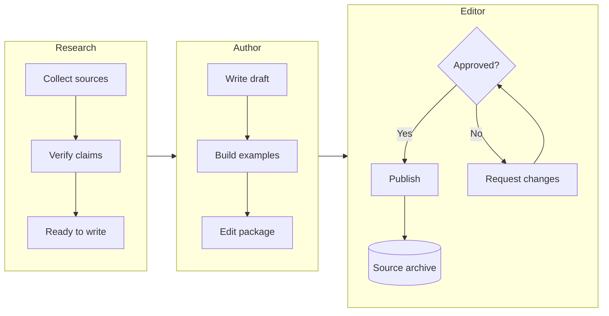

Group→group arrows connect ownership stages. The revision loop stays inside
the editor's box because that is whose work it is.

### 2. Layered architecture

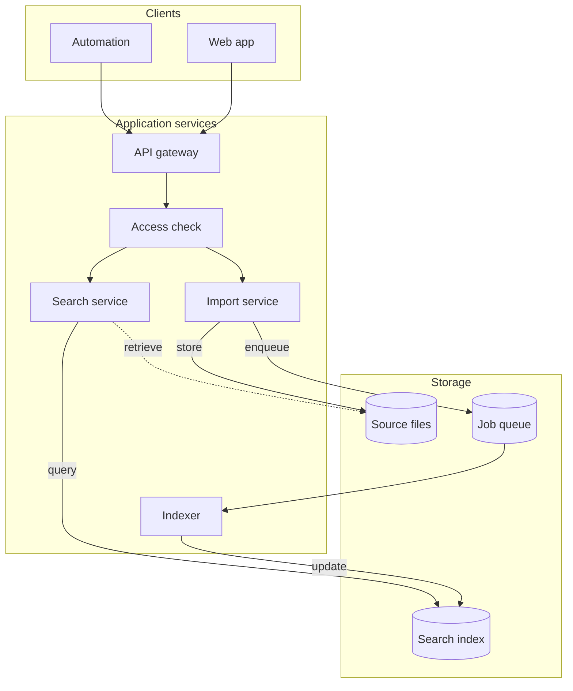

Group by responsibility. Cylinders mark storage. One gateway, drawn once,
because it is one component — do not duplicate a shared node per client.

### 3. Parallel checks and the gate that joins them

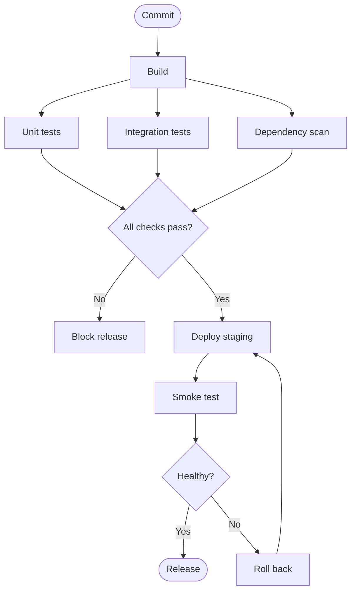

Fan-out then fan-in: the checks are siblings, not a chain, and the diamond is
their shared decision. The rollback loop is drawn, not footnoted.

### 4. Sequence blocks for alternatives and retries

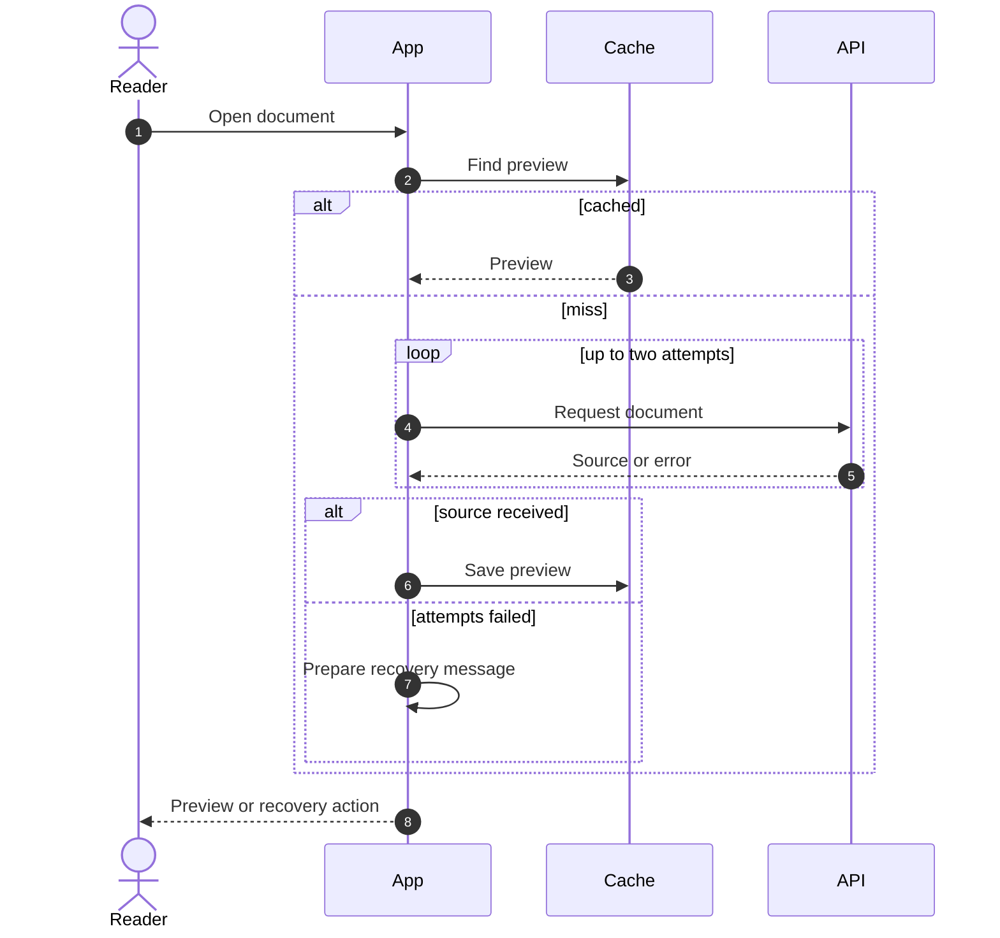

Declare participants left-to-right in order of first interaction. `autonumber`
makes steps referenceable in prose. A retry loop belongs only inside the
branch where it can happen. Do not deactivate (`-`) a participant in both
branches of an `alt` — the parser tracks activations linearly.

### 5. Store vs transform, with the rejection path visible

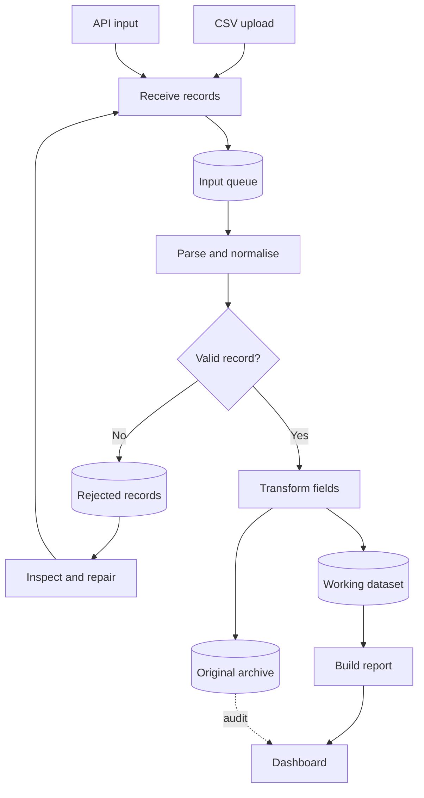

Boxes transform, cylinders store. The No branch goes all the way back to
intake. The audit link is dotted because it is a different kind of edge.

### 6. One class vocabulary across outcomes

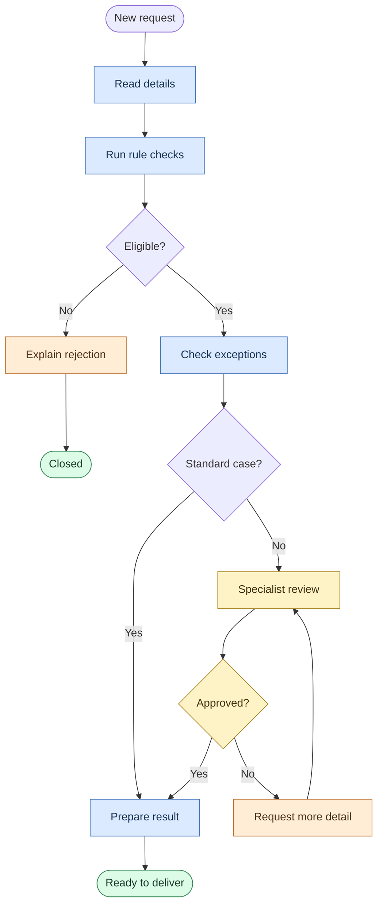

Colour is responsibility (automated / manual / terminal / exception); shape
is node kind. `expert` and `approval` share a colour and differ in shape.
Change one `classDef` to restyle a category. Every `classDef` sets all three
of fill, stroke, color.

### 7. Main path solid, signals dotted

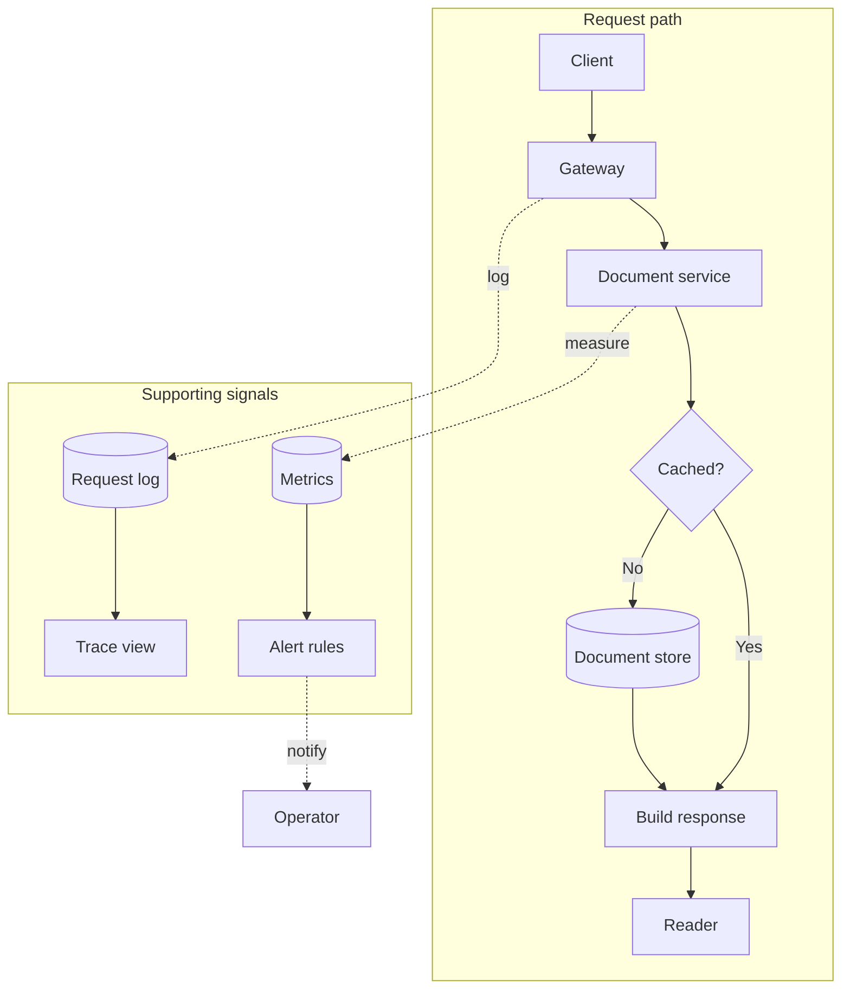

Caption: "Solid arrows are the request path; dotted arrows are observability."

### 8. Composite states

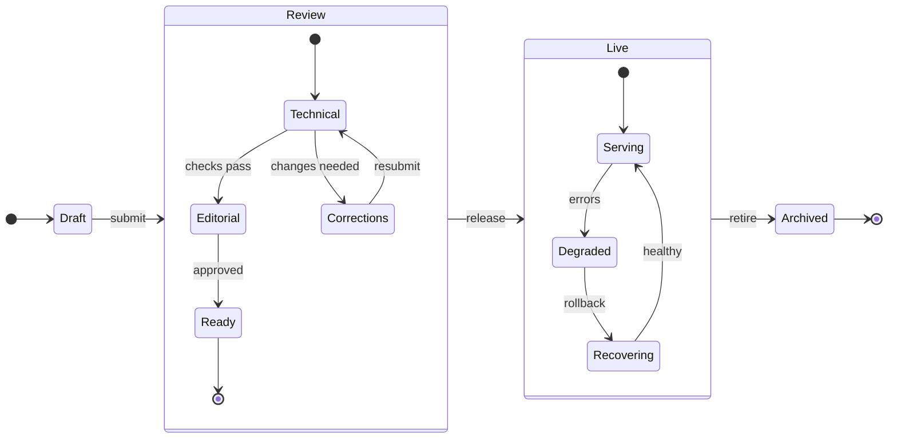

A stage keeps its own progression and recovery path inside it. Transition
labels are events. Check every route back to a working state. Two levels of
nesting at most.

### 9. Cardinality on the figure, join entity for many-to-many

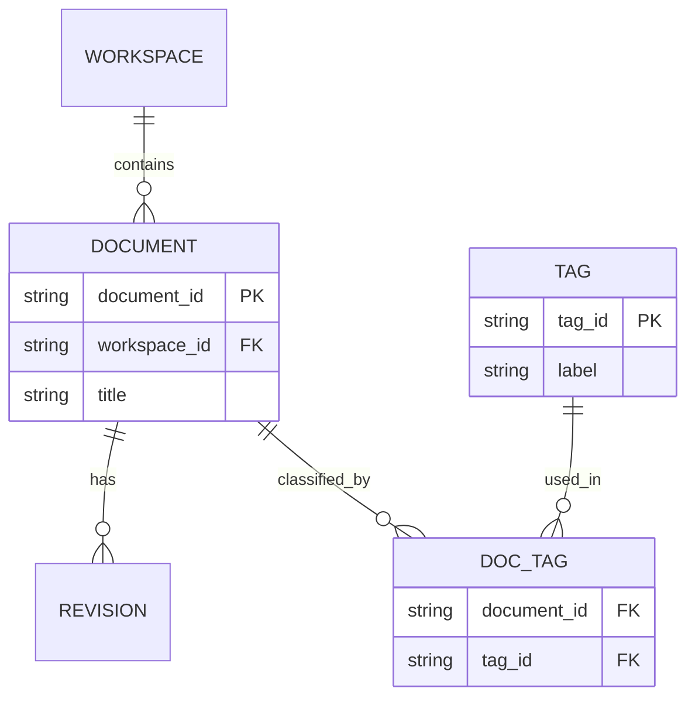

`DOC_TAG` makes the many-to-many explicit. Read both ends of every
relationship; `||--o{` is "exactly one to zero-or-more", left end first.

### 10. One shared node, not three copies

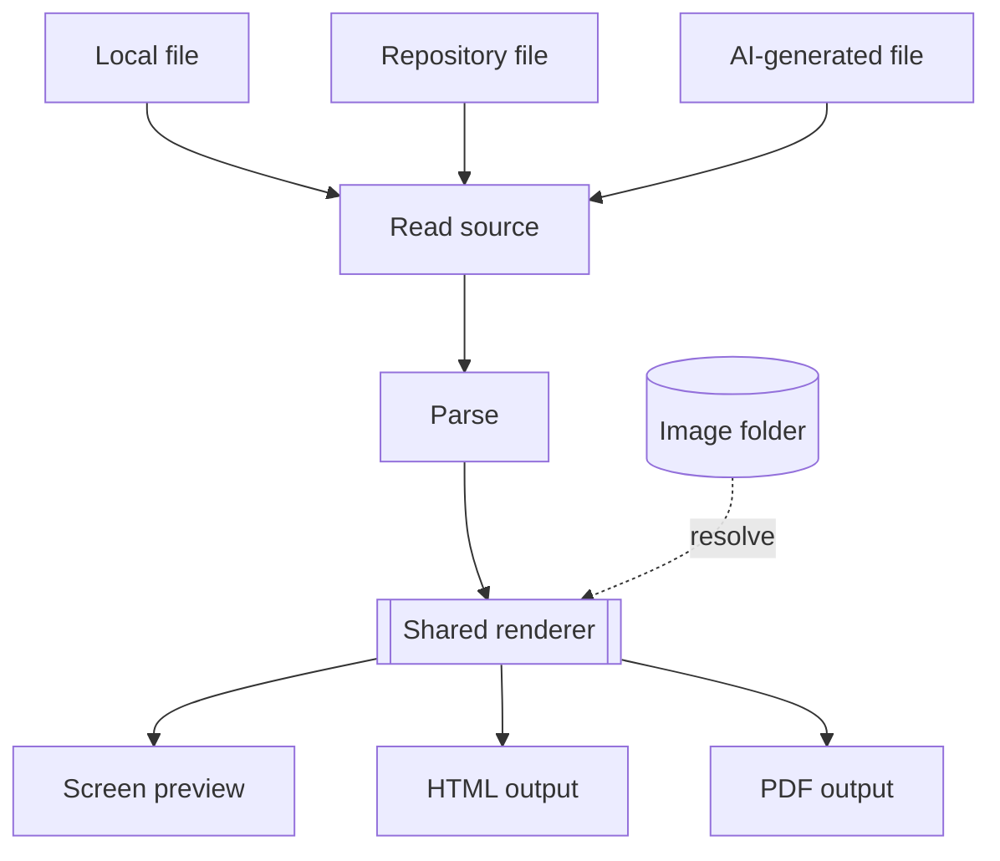

Three inputs converge on one parser and renderer, which fans out to three
outputs. One node id for the shared component shows the dependency — and why
a failure there affects every output.

### 11. Mindmap shape vocabulary

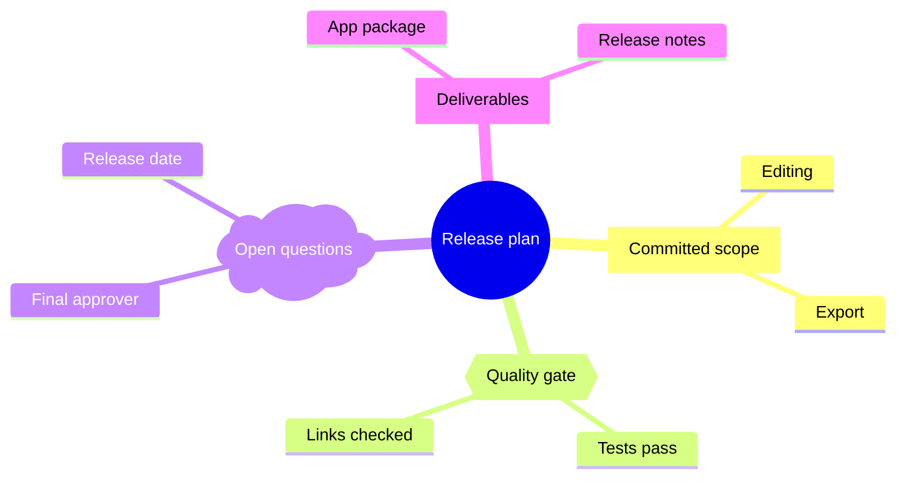

`[ ]` work, `{{ }}` a gate, `) (` an open question (cloud). Indentation is the
hierarchy; the radial layout is not a schedule. Note the cloud is a single
paren each side — `)) ((` is a different shape (bang).

### 12. Gantt with dependencies, a milestone and a critical route

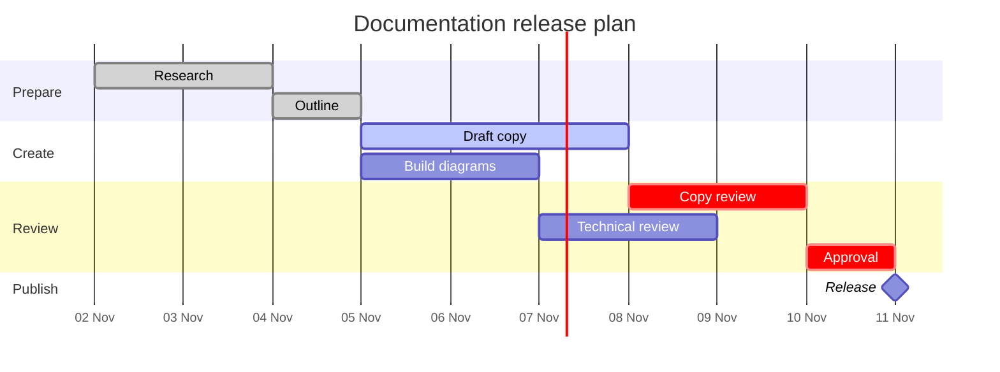

`after a b` waits for both. A milestone is `0d`. `crit` is an author
annotation — Mermaid does not compute the critical path.

## Attribution

Techniques 1–12 are adapted, in our own words and with new examples, from
Yugene Lee, "Your Markdown Diagrams Could Look Like This: 12 Mermaid Tricks
Worth Copying" (Medium, 2026). The group→group vs node→node guidance follows
the Mermaid style guide in agent-skills-hub/agent-skills-hub
(`skills/markdown-mermaid-writing`, MIT).
